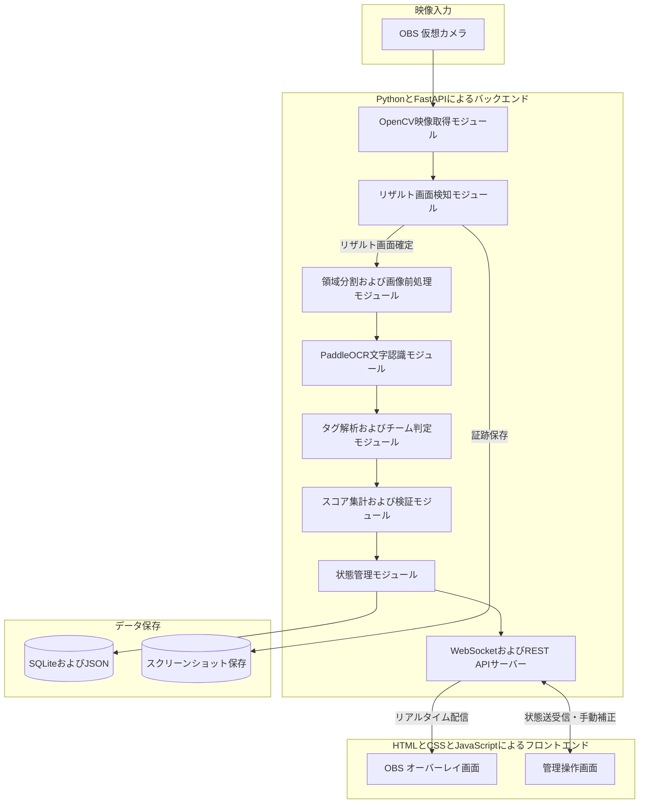
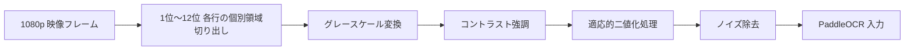
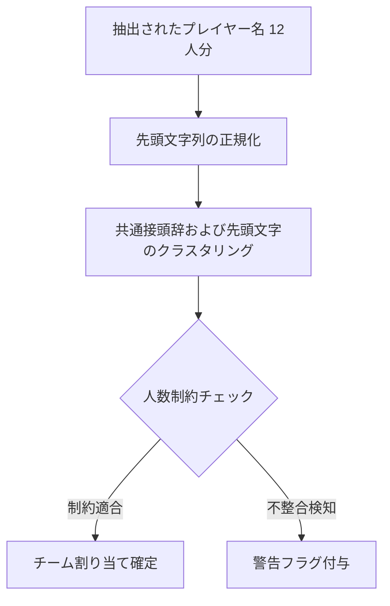

# マリオカート8 デラックス OBS自動集計・オーバーレイシステム 詳細設計書

## 1. システム概要

本システムは、OBSの仮想カメラ出力からマリオカート8 デラックスのレース映像をリアルタイムに取得し、レース終了時のリザルト画面を画像処理およびOCR技術によって自動検知・解析して、チームごとの得点を自動集計し、OBSのブラウザソースとして動作するオーバーレイ画面へ即座に反映する配信支援システムです。

### 基本諸元
* **対象ゲーム**: マリオカート8 デラックス
* **対戦形式**: 2v2（6チーム）、3v3（4チーム）、4v4（3チーム）
* **最大レース数**: 12レース
* **入力ソース**: OBS 仮想カメラ（1920x1080 60fps または 30fps 推奨）
* **出力先**: OBS ブラウザソース用オーバーレイ画面、Webブラウザ用管理画面

---

## 2. システム全体アーキテクチャ

システムは大きく「映像解析とOCRエンジン」「集計と状態管理コア」「Webサーバーと通信レイヤー」「フロントエンド画面」の4つの層で構成されます。



---

## 3. 映像入力および画像解析パイプライン設計

### 3.1 映像キャプチャとフレームレート制御
* OpenCVの `VideoCapture` を用いて仮想カメラデバイスを開きます。
* 映像全体を毎フレームOCRにかけると過剰な計算負荷が発生するため、解析周期を分離します。
  * **画面検知周期**: 1秒あたり2回〜3回（300ミリ秒〜500ミリ秒間隔）。軽量な特徴領域の照合のみ実行。
  * **文字認識処理**: リザルト画面の静止・確定を検知した瞬間のみ実行。

### 3.2 リザルト画面検知ロジック
マリオカート8 デラックスのリザルト画面は、特定位置に固定のUI要素が表示されます。
* **検知手法**:
  1. 画面上部のヘッダー領域（レース結果または総合結果を示す帯や文字アイコン）に対するテンプレート照合。
  2. 画面下部のボタンガイド領域の特徴色・形状の判定。
* **画面静止判定**:
  * 表彰やアニメーション終了後、リザルトリストが完全に停止したことを確認するため、連続する2フレーム間の差分が閾値以下になったタイミングでキャプチャを確定します。

### 3.3 領域分割と画像前処理
画面サイズ 1920x1080 を基準とし、1位〜12位の表示位置を個別に関心領域として切り出します。

* **マリオカート8 デラックスのリザルト画面構成**:
  * 左列: 1位 〜 6位
  * 右列: 7位 〜 12位
* **切り出し対象領域**:
  * 順位アイコン領域
  * プレイヤー名領域
  * スコア領域



* **前処理パラメータの最適化**:
  * 背景にコースやキャラクターが透けて映り込むため、文字色と輪郭を抽出しやすいよう、明度閾値処理およびコントラスト強調を施します。

### 3.4 文字認識
* **採用エンジン**: PaddleOCR（軽量・高精度な日本語モデルおよび英数字認識を活用）
* **認識対象ごとの辞書・文字種制限**:
  * **スコア領域**: 数字のみに限定（1〜15の範囲）。認識精度を向上させ誤読を排除。
  * **名前領域**: 日本語、英数字、記号を対象として認識。

---

## 4. タグ・名前解析およびチーム判定ロジック設計

ラウンジルールに準拠した厳格なチームタグ判定アルゴリズムを実装します。

### 4.1 タグ判定ルールと正規化処理

1. **先頭文字の一致**:
   * 同一チームの所属プレイヤーは、必ず同じ文字から始まるタグを使用します。
2. **大文字・小文字の同一視**:
   * 英字の大文字と小文字は同一として扱います。正規化処理で小文字に統一して比較します。
3. **ひらがな・カタカナの同一視**:
   * 同音のひらがなとカタカナは同一として扱います。文字コード正規化処理により、すべてカタカナに統一して比較します。
4. **濁音・半濁音の厳格な区別**:
   * 清音（「た」）、濁音（「だ」）、半濁音（「ぱ」）は明確に別の文字として区別します。Unicodeの正規化で濁点を分離・除去しないよう配慮します。
5. **ラテン文字制限**:
   * 分音記号付き文字（ウムラウト、アクセント等）への代用は禁止ルールに基づき検知します。

### 4.2 チームクラスタリングアルゴリズム
対戦形式に応じた人数制約（2v2なら各2名、3v3なら各3名、4v4なら各4名）を利用して、最も確からしいタグとチーム分けを自動推定します。



---

## 5. スコア集計・検証・状態管理設計

### 5.1 スコア集計ロジック
* **各順位の配点定数**:
  * 1位: 15点, 2位: 12点, 3位: 10点, 4位: 9点, 5位: 8点, 6位: 7点
  * 7位: 6点, 8位: 5点, 9位: 4点, 10位: 3点, 11位: 2点, 12位: 1点
* **検証機能**:
  * **合計点検証**: 1レースの12名の合計得点が「82点」であることを検証。82点でない場合はOCR誤読フラグを立てて管理画面へ通知。
  * **順位スコア整合性**: 各順位の配点が規定の12個の得点集合と完全一致するか検証。

### 5.2 重複集計防止とレース進行管理
* **状態遷移モデル**:
  * `WAITING_RACE`: レース中（リザルト画面の検出待ち）
  * `RESULT_DETECTING`: リザルト画面候補を検出、安定化待機（1〜2秒間静止確認）
  * `PROCESSING`: 画面切り出し、OCR実行、集計処理
  * `COOLDOWN`: 集計完了後のロック状態。リザルト画面が消えるか、最低60秒間は同一レースの再集計を行わない
* **レース番号の自動歩進**:
  * バリデーションを通過、または手動承認された時点で現在のレース番号（1〜12）をインクリメント。

### 5.3 データモデル

```sql
-- レースセッション管理
CREATE TABLE sessions (
    id TEXT PRIMARY KEY,
    format TEXT NOT NULL, -- '2v2', '3v3', '4v4'
    total_races INTEGER DEFAULT 12,
    current_race INTEGER DEFAULT 0,
    created_at TIMESTAMP DEFAULT CURRENT_TIMESTAMP
);

-- チーム情報
CREATE TABLE teams (
    id INTEGER PRIMARY KEY AUTOINCREMENT,
    session_id TEXT NOT NULL,
    tag_name TEXT NOT NULL,
    normalized_tag TEXT NOT NULL,
    color_code TEXT
);

-- 各レースの結果
CREATE TABLE race_results (
    id INTEGER PRIMARY KEY AUTOINCREMENT,
    session_id TEXT NOT NULL,
    race_number INTEGER NOT NULL,
    is_valid BOOLEAN DEFAULT TRUE,
    screenshot_path TEXT,
    created_at TIMESTAMP DEFAULT CURRENT_TIMESTAMP
);

-- プレイヤーごとのリザルト明細
CREATE TABLE player_scores (
    id INTEGER PRIMARY KEY AUTOINCREMENT,
    race_result_id INTEGER NOT NULL,
    rank INTEGER NOT NULL,
    player_name TEXT NOT NULL,
    team_id INTEGER,
    score INTEGER NOT NULL,
    raw_ocr_text TEXT
);
```

---

## 6. 通信および外部連携設計

### 6.1 WebSocket イベント仕様
バックエンドとフロントエンド（オーバーレイ画面および管理画面）はローカルWebSocketで常時接続します。

* **サーバーからクライアントへの配信イベント**:
  * `STATE_UPDATE`: 全体スコア情報、現在のレース番号、順位表、点数差、バリデーション状態の配信。
  * `ALERT`: 合計点不一致やタグ不整合など、手動確認が必要な警告通知。
* **管理画面からサーバーへの送信イベント**:
  * `CORRECT_SCORE`: 誤認識されたスコアや順位の手動修正。
  * `RENAME_TEAM`: 誤認識されたタグ名やチーム割り当ての手動変更。
  * `SET_RACE`: レース番号の手動変更や再集計トリガー。
  * `RESET_MATCH`: 対戦のリセットおよび新規セッション開始。

---

## 7. ユーザーインターフェース設計

### 7.1 OBS オーバーレイ画面
* **構成**:
  * レース番号表示（例: `Race 4 / 12`）
  * チームランキングボード（順位、チームタグ、合計得点、1位との点数差）
  * 直前レースの獲得点数アニメーション
* **デザイン配慮**:
  * 背景を完全透過とし、OBS上でゲーム画面を邪魔しないコンパクトなレイアウト。
  * チームごとのカラーバー表示。

### 7.2 管理操作画面
* **構成要素**:
  1. **リアルタイムモニター**: 仮想カメラ映像とリザルト検知状態（待機中、解析中、完了）の表示。
  2. **最新リザルト確認パネル**: OCR検知直後に自動保存されたスクリーンショットと、読み取り結果（1〜12位のリスト）を並べて表示。
  3. **クイック修正機能**: 名前、タグ、点数をその場で編集可能なテーブル。合計82点に達していない場合は赤字で強調表示。
  4. **マッチコントロール**: 形式選択（2v2、3v3、4v4）、レース手動送り、全データ初期化ボタン。

---

## 8. 実装ロードマップと推奨開発手順

ご提示いただいた推奨手順に沿って、確実に動作を検証しながら段階的に実装を進めます。

### ステップ1: 単一画像による画像切り出しとOCR検証
* **目的**: 静止画から1位〜12位の名前と点数を高精度で読み取る処理の確立。
* **作業内容**:
  * リザルト静止画の解像度確認と関心領域の座標定義。
  * OpenCVによる前処理（グレースケール変換、二値化、ノイズ除去）の適用。
  * PaddleOCRによるテキスト認識精度の検証。
  * タグ抽出とラウンジルールに基づく正規化アルゴリズムの実装。

### ステップ2: 動画入力によるリザルト画面検知と状態管理の実装
* **目的**: 映像からリザルト画面の出現を自動検知し、重複なく安全に集計する制御の実装。
* **作業内容**:
  * テンプレート照合を用いたリザルト画面の自動検知。
  * 画面静止判定と二重集計防止機構の実装。
  * レース番号進行と82点バリデーション機能の実装。
  * 検知時スクリーンショットのローカル保存処理。

### ステップ3: 仮想カメラ接続、Webサーバー、フロントエンド統合
* **目的**: OBS連携と管理操作画面を含めたシステム全体の完成。
* **作業内容**:
  * OpenCVによるOBS仮想カメラデバイス接続。
  * FastAPIによるバックエンド構築とWebSocket通信の実装。
  * OBS向けオーバーレイ画面の実装。
  * 手動補正およびプレビュー用管理画面の実装。
